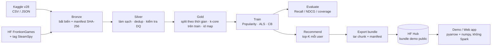

# steam-rec

**Hệ thống gợi ý game Steam theo lô (batch).** Spark ELT chạy trên lake Bronze → Silver → Gold, huấn luyện 3 model
(popularity, implicit ALS, content-based TF-IDF), đánh giá bằng split theo mốc thời gian chung không rò rỉ dữ liệu, và
phục vụ top-K tính sẵn qua demo offline cùng web app Next.js + FastAPI.


| | |
|---|---|
| **Dữ liệu** | Kaggle *Game Recommendations on Steam* v28: 41.2M review, 14.3M user, 50.9k game (10/2010 → 12/2022) |
| **Model** | Popularity · implicit ALS (Spark MLlib) · TF-IDF item-kNN trên tags, genres, categories và mô tả |
| **Kết quả tốt nhất** | ALS **Recall@20 = 0.124**, **NDCG@20 = 0.055** trên 100k user test, gấp 2.2 lần popularity |
| **Quy mô** | 21.4M tương tác train × 3.0M user × 30.7k game; toàn bộ pipeline ≈ 30 phút trên một VM 8 vCPU |
| **Phục vụ** | Top-K tính sẵn cho 180k user, cold-start theo tag/genre, fallback popularity; không cần Spark khi phục vụ |

---

## Mục lục
- [Kiến trúc](#kiến-trúc)
- [Kết quả](#kết-quả)
- [Phương pháp đánh giá](#phương-pháp-đánh-giá)
- [Bắt đầu nhanh: demo trong 3 lệnh](#bắt-đầu-nhanh-demo-trong-3-lệnh)
- [Web app](#web-app)
- [Chạy pipeline](#chạy-pipeline)
- [Cấu trúc repo](#cấu-trúc-repo)
- [Kiểm thử và chất lượng code](#kiểm-thử-và-chất-lượng-code)
- [Nguyên tắc kỹ thuật](#nguyên-tắc-kỹ-thuật)
- [Lộ trình](#lộ-trình)
- [Nguồn dữ liệu và miễn trừ](#nguồn-dữ-liệu-và-miễn-trừ)

## Kiến trúc



- **Lưu trữ.** Lake nằm trên object store tương thích S3 ([PGSTY SILO](infra/silo/docker-compose.yml), chạy Docker
  local) hoặc trên filesystem thường (`--env demo`). Mọi bảng Silver/Gold và artifact đều gắn với một `run_id`
  (`<timestamp UTC>-<git sha>-<hash config>`). Mỗi stage ghi marker `_SUCCESS`, nên chạy lại sẽ tiếp tục từ chỗ dừng
  thay vì tính lại từ đầu.
- **Tính toán.** Spark `local[*]` trên một máy. Run full chạy trên VM Google Colab CPU high-mem, checkpoint lên Drive
  sau mỗi stage, rồi trả kết quả về dưới dạng bundle có kiểm tra SHA-256 (xem [`docs/runbook-colab.md`](docs/runbook-colab.md)).
- **Phục vụ.** `steam_rec.serving.demo.Demo` đọc top-K, catalog và ma trận CB đã export bằng pyarrow/numpy. Mỗi lần tra
  mất khoảng 40 ms và chạy hoàn toàn offline.

## Kết quả

Run `20261125T045027Z-dbf308a-v2full`. Cửa sổ test (11–12/2022) chỉ được đánh giá **một lần**, sau khi đã chọn model
trên validation, với 100,000 user lấy mẫu tất định.

| Model | Recall@10 | NDCG@10 | Recall@20 | NDCG@20 | Catalog coverage@20 | Eligible users |
|---|---:|---:|---:|---:|---:|---:|
| Popularity | 0.0339 | 0.0174 | 0.0565 | 0.0234 | 0.2% | 100% |
| **ALS** (rank 32, α = 5, λ = 0.1) | **0.0781** | **0.0428** | **0.1243** | **0.0552** | 2.6% | 100% |
| CB TF-IDF (w_desc = 1.0, 100 hàng xóm) | 0.0278 | 0.0153 | 0.0440 | 0.0196 | **65.7%** | 100% |

| Stage (full, Colab 8 vCPU) | silver | gold | train | evaluate | recommend |
|---|---:|---:|---:|---:|---:|
| Thời gian (giây) | 204 | 163 | 1,275 | 54 | 36 |

Grid validation, các run trước và lưu ý xem ở [`reports/benchmark.md`](reports/benchmark.md) và
[`reports/benchmark_notes.md`](reports/benchmark_notes.md). Kết quả v1 (leave-last-out theo từng user) **không so sánh
trực tiếp** được với bộ số này.

## Phương pháp đánh giá

Thiết kế đánh giá là trọng tâm của v2: số liệu offline phải phản ánh đúng những gì model gặp khi triển khai thật.

- **Split theo mốc thời gian chung.** Mọi user dùng chung mốc cắt: train `< 2022-09-01` ≤ validation `< 2022-11-01` ≤
  test. Leave-last-out theo từng user đã bị bỏ vì nó làm rò rỉ tương tác tương lai của *user khác* vào train. Mốc được
  chọn qua một EDA riêng ([`reports/eda_time_split.md`](reports/eda_time_split.md)): validation rơi vào giai đoạn lưu
  lượng bình thường, test bao trọn đợt Autumn Sale và Winter Sale.
- **k-core 3/5 chỉ trên cửa sổ train**, nên các giai đoạn giữ lại để đánh giá không ảnh hưởng tới tập user/game huấn luyện.
- **Metric nhiều target.** Target của mỗi user là toàn bộ review tích cực của họ trong cửa sổ (trung bình 1.45).
  Recall@K = số trúng / min(K, |target|); NDCG dùng thứ hạng lý tưởng của min(K, |target|) item.
- **Mask lịch sử.** Ứng viên gợi ý loại bỏ mọi game user đã review trước mốc cắt của cửa sổ.
- **Báo cáo riêng item lạnh.** 23.8% target test là game không có trong dữ liệu train (chủ yếu là game mới ra). Không
  model CF nào gợi ý được những game này, nên chúng được đếm và báo cáo riêng, không tính vào metric.
- **Test một lần.** Hyper-parameter được chọn theo NDCG@20 trên validation, test chỉ chạy một lần.

Các cổng kiểm tra chất lượng dữ liệu (mức fail hoặc warn) chạy ở Silver: schema, trùng lặp, toàn vẹn khóa ngoại
(`app_id`, `user_id`), độ phủ metadata theo game và theo tương tác tích cực. Sau khi bổ sung metadata, 99.8% tương
tác tích cực nằm trên game có tag (dữ liệu v28 gốc chỉ có 48.8%). Data contract xem ở
[`docs/data-contracts.md`](docs/data-contracts.md).

## Bắt đầu nhanh: demo trong 3 lệnh

Cần [uv](https://docs.astral.sh/uv/) và Python 3.13. Không cần Spark, Docker, tài khoản cloud hay token.

```bash
uv sync
uv run --with huggingface_hub python scripts/demo/fetch_bundle.py   # ~113 MB từ HF dataset public, có kiểm tra SHA-256
uv run steam-rec demo --env demo --user-id 378 --model als          # als | cb | popularity
```

```bash
uv run steam-rec demo --env demo --tags "RPG,Open World"            # cold-start theo tag (dùng được cả token genre như g_rpg)
uv run steam-rec demo --env demo --user-id 1 --exclude 440,570      # user lạ: popularity, bỏ các game đã review
```

API thư viện (`Demo.for_user`, `Demo.for_new_user`) và định dạng output được mô tả trong
[`docs/web-demo.md`](docs/web-demo.md).

## Web app

Giao diện kiểu cửa hàng Steam, dùng chung object `Demo`: feed gợi ý cá nhân có chuyển model, trang game kèm game tương
tự, duyệt theo tag và genre, tìm game theo tên, trang About trình bày benchmark.

```bash
# sau phần Bắt đầu nhanh (bundle đã nằm trong data/lake)
uv run --group web uvicorn main:app --app-dir web/backend --port 8000      # API: http://localhost:8000/docs
cd web/frontend && npm install
echo "NEXT_PUBLIC_API_URL=http://localhost:8000" > .env.local
npm run dev                                                                # UI:  http://localhost:3000
```

User mẫu của run v2: `378`, `671`, `694`, `856`. API contract, biến môi trường và ghi chú cho Windows xem ở
[`web/README.md`](web/README.md), [`web/backend/README.md`](web/backend/README.md) và
[`web/frontend/README.md`](web/frontend/README.md).

## Chạy pipeline

### Cài đặt local

Cần Python 3.13, Java 17+ và Docker.

```bash
uv sync
cp infra/silo/.env.example infra/silo/.env && cp .env.example .env    # đặt cùng một mật khẩu dài ở cả hai file
docker compose -f infra/silo/docker-compose.yml up -d                 # object store tại 127.0.0.1:9000 (console :9001)
uv run steam-rec storage init                                         # tạo bucket steam-rec
```

Thông tin đăng nhập Kaggle đọc từ `~/.kaggle/kaggle.json`, nằm ngoài repo.

### Các lệnh

```bash
uv run steam-rec ingest                          # Kaggle v28 (cố định version) -> Bronze + manifest (chạy lại = no-op)
uv run steam-rec ingest-meta                     # HF FronkonGames + SteamSpy -> Bronze game_meta (chạy tiếp được)
uv run steam-rec run all --scale smoke           # silver -> gold -> train -> evaluate -> recommend (~2 phút)
uv run steam-rec run all --scale dev             # ~1M review (~5 phút)
uv run steam-rec run train --run-id <run_id>     # chạy tiếp: stage đã xong sẽ được bỏ qua
uv run steam-rec report                          # sinh lại reports/benchmark.md
uv run steam-rec eda-time                        # so sánh các cặp mốc split -> reports/eda/eda_time_split.json
```

Các mức quy mô (`smoke`, `dev`, `full`) và grid model nằm trong [`configs/`](configs). Xem cấu hình đã gộp bằng
`uv run steam-rec show-config`.

### Chạy full trên Colab

Các stage trên dữ liệu full được thiết kế cho VM CPU high-mem: code gửi lên dưới dạng snapshot, Bronze tải thẳng trên
VM, mỗi stage checkpoint lên Drive. [`scripts/colab/run_stage.py`](scripts/colab/run_stage.py) điều phối các stage;
[`docs/runbook-colab.md`](docs/runbook-colab.md) ghi quy tắc vận hành (timeout, checkpoint, dừng VM). Kết quả trả về
dưới dạng bundle chia nhỏ:

```bash
uv run steam-rec import --bundle-dir data/inbox/<run_id>     # kiểm tra SHA-256 từng part và từng file rồi import
python scripts/demo/publish_bundle.py <run_id>              # chủ dự án: phát hành bundle demo lên HF Hub
```

## Cấu trúc repo

```
src/steam_rec/
  ingestion/     snapshot Kaggle vào Bronze, bổ sung metadata game (HF, SteamSpy)
  pipelines/     silver, gold, modeling (train / evaluate / recommend / export), EDA, bộ chạy stage
  features/      split theo thời gian, k-core, tương tác CF
  models/        popularity, ALS, CB TF-IDF, bộ chấm top-K dùng chung có mask lịch sử
  evaluation/    Recall / NDCG / coverage (Python + Spark), báo cáo benchmark
  serving/       Demo offline (pyarrow + numpy)
  storage/       store S3 / local, đường dẫn lake, export bundle và import có kiểm tra
  common/        config (pydantic + YAML), Spark session, run_id, logging
configs/         base, môi trường (local / colab / demo), quy mô (smoke / dev / full), grid model
scripts/colab/   bootstrap và bộ chạy stage cho VM Colab
scripts/demo/    tải / phát hành bundle demo (HF Hub)
web/             adapter FastAPI (backend/) + giao diện Next.js 16 (frontend/)
infra/silo/      object store tương thích S3 chạy local (Docker Compose)
tests/           unit (Spark local[2], lake giả) + integration (cần object store)
docs/ reports/   data contract, runbook, ghi chú nghiên cứu, báo cáo EDA và benchmark
```

## Kiểm thử và chất lượng code

```bash
uv run pytest                                              # unit test, gồm Spark local: split không rò rỉ, k-core, metric, mask
uv run --group web pytest tests/unit/test_web_backend.py   # API web trên lake giả
uv run pytest -m integration -o addopts=""                 # cần object store đang chạy (boto3 + s3a)
uv run ruff check src scripts tests web/backend
cd web/frontend && npm run lint && npm run build
```

## Nguyên tắc kỹ thuật

- **Tái lập được.** Version Kaggle được cố định, Bronze bất biến kèm manifest SHA-256, mọi output gắn `run_id`, và
  hash của config nằm trong `run_id`.
- **Idempotent và chạy tiếp được.** Stage có marker `_SUCCESS` sẽ được bỏ qua; huấn luyện dài được tách thành từng lần
  fit theo cấu hình, có thể chạy tiếp khi bị ngắt.
- **Truyền dữ liệu có kiểm tra.** Bundle được chia nhỏ; khi import, từng part và từng file đều được đối chiếu với manifest.
- **Không có secret trong git.** Thông tin đăng nhập nằm ở `~/.kaggle`, `.env` (đã gitignore) hoặc cache token của CLI.
- **Ưu tiên một máy.** Spark `local[*]` xử lý được 41M review. Chuyển sang cluster hay Apache Iceberg là thay đổi cấu hình
  và lớp lưu trữ (xem [`docs/research-iceberg.md`](docs/research-iceberg.md)), không phải viết lại.

## Lộ trình

- Huấn luyện lại định kỳ (Airflow): refit trên train + validation và trên toàn bộ dữ liệu để phục vụ, kèm theo dõi drift.
- Chấm điểm online từ user/item factor đã export, để phục vụ mọi user thay vì chỉ user có top-K tính sẵn.
- Crawler tăng dần cho Steam Web API (`playtime_at_review`, dữ liệu 2023+, game mới) với namespace user riêng.
- Cải thiện "game tương tự" trên trang game (dùng item factor của ALS hoặc CB có tính tới độ phổ biến).
- Bảng Apache Iceberg (snapshot, time travel, schema evolution) thay cho thư mục `run=<id>`.

## Nguồn dữ liệu và miễn trừ

- Review, user và game lấy từ dataset Kaggle *Game Recommendations on Steam* (version 28).
- Mô tả, genres và categories của game lấy từ HF dataset `FronkonGames/steam-games-dataset` (MIT, cố định revision).
  Tag cho các game thiếu tag trong v28 lấy từ API SteamSpy.
- Bundle demo được phát hành tại HF dataset
  [`paingoat/steam-rec-demo`](https://huggingface.co/datasets/paingoat/steam-rec-demo).

Đây là đồ án môn Big Data, không liên kết và không được bảo trợ bởi Valve Corporation. Steam và logo Steam là nhãn hiệu
của Valve Corporation. Ảnh game trong web app được tải từ CDN công khai của Steam.
