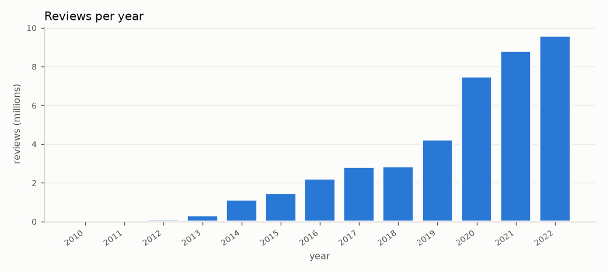
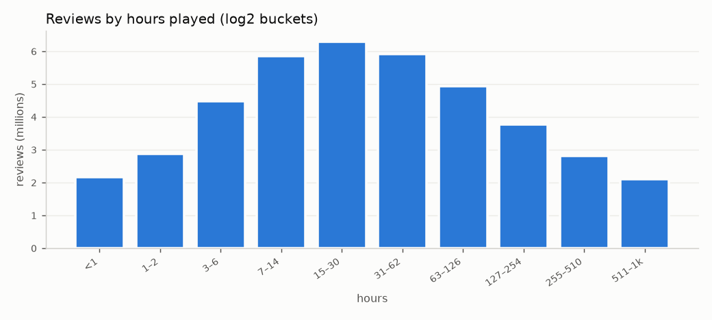
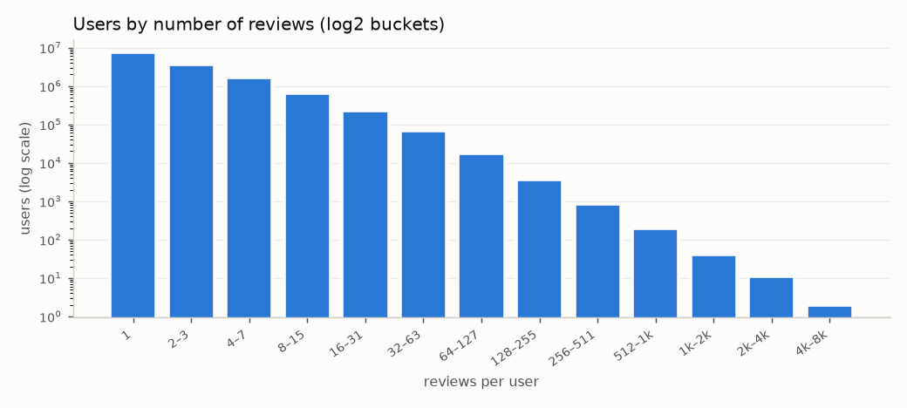

# EDA — Kaggle Game Recommendations on Steam v28

Nguồn: Bronze `bronze/kaggle/v28/20261111T020628Z`, toàn bộ dữ liệu. Chạy bằng `uv run steam-rec eda --scale dev`
(Spark `local[8]`, driver 5 GB, khoảng 5 phút trên máy local). Số liệu chi tiết ở `reports/eda/eda_summary.json`.
Tất cả percentile là **giá trị chính xác**, không phải xấp xỉ.

## 1. Schema và chất lượng
| File | Số dòng | Header khớp schema | Null |
|---|---|---|---|
| games.csv | 50,872 | ✅ | 0 |
| games_metadata.json | 50,872 (`app_id`, `description`, `tags`) | — | — |
| users.csv | 14,306,064 | ✅ | 0 |
| recommendations.csv | 41,154,794 | ✅ | 0 |

- `review_id` không trùng. Có **21 cặp (user, app) trùng**, cần dedup.
- Toàn vẹn khóa ngoại: mọi `app_id` trong recommendations đều có trong games; mọi `user_id` đều có trong users.
  Mọi game đều có metadata. Có 525,005 user trong `users.csv` nhưng không có review nào.
- `users.reviews` khớp 100% với số review đếm được, nên đây là cột suy ra, không phải thông tin mới.
- Metadata: 10,373 game có description rỗng (20%), 1,244 game không có tag. Trung bình 11.5 tag/game,
  441 tag khác nhau, description trung bình chỉ khoảng 160 ký tự. **Tags là tín hiệu CB chính.**

## 2. Recommendations
- Khoảng thời gian 2010-10-15 → 2022-12-31. Lượng review tăng mạnh từ 2019; riêng 2020–2022 chiếm 63%.
  
- **85.8% là review tích cực.** Tỉ lệ tích cực theo năm dao động từ 0.81 đến 0.97.
- `hours`: median 27.3, p99 864.5, **max 1000**. Nguồn đã cap ở 1000. 176k dòng có hours = 0, 2.16M dòng < 1 giờ.
  Review tiêu cực có median hours thấp hơn hẳn (11.1 so với 30.4 ở review tích cực).
  

## 3. Độ thưa
- 13.78M user có review, 37.6k game có review. Mật độ khoảng 7e-5 (chỉ tính positive).
- Số review mỗi user: **median 1**, p90 = 6, p99 = 25, p99.9 = 79, max 6,045 (đuôi rất dài).
  Số user có ≥ 3 positive: **3.30M**; ≥ 5 positive: 1.62M.
  
- Số positive mỗi game: median 28, p99 khoảng 20k, max 295k (popularity bias mạnh).
- Có 4.3% user có hai positive cuối cùng ngày, nên split cần tie-break bằng `review_id`.

## 4. K-core trên positive (lặp đến khi hội tụ, tối đa 8 vòng)
| min_user / min_item | users | items | interactions | density | ALS factors rank 64 | vòng |
|---|---|---|---|---|---|---|
| 1 / 1 | 12.66M | 37,419 | 35.30M | 7.5e-5 | 3.25 GB | 1 |
| **3 / 5** | **3.30M** | **32,692** | **23.69M** | 2.2e-4 | **0.85 GB** | 5 |
| 5 / 10 | 1.62M | 26,064 | 17.99M | 4.3e-4 | 0.42 GB | 8 |
| 5 / 20 | 1.62M | 19,688 | 17.88M | 5.6e-4 | 0.42 GB | 7 |
| 10 / 20 | 0.54M | 17,916 | 11.02M | 1.1e-3 | 0.14 GB | chưa hội tụ sau 8 vòng (dao động < 0.01%) |

## 5. Hệ quả cho thiết kế (đề xuất cho Gate 2, chi tiết ở `docs/data-contracts.md`)
1. Cần **lọc k-core**. 92% user có < 3 positive, nên không đánh giá per-user được với các user này. Mặc định đề xuất 3/5.
2. **Split theo thời gian cho từng user, leave-last-out** trên positive. Mỗi eval user có 1 item ở test và 1 ở validation.
3. Confidence `1 + log1p(hours)`; review tiêu cực được dùng để mask candidate, không đưa vào ALS.
4. CB nên ưu tiên trọng số tags hơn description, vì description ngắn và 20% rỗng.
5. **Tài nguyên:** EDA full chạy local mất khoảng 5 phút, trong khi factor ALS ở cấu hình 3/5 chỉ khoảng 0.85 GB.
   Vì vậy ETL full có thể chạy local. ALS full cần thử trên Colab high-mem hoặc local tùy kết quả benchmark ở mức dev.
